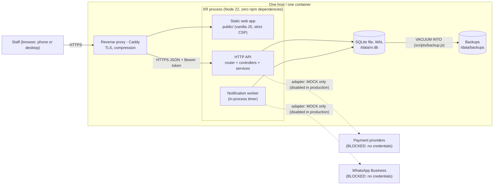

# C4 update — Stage 12 (current implemented state vs. target)

This file **supersedes** `c4/C2_CONTAINER_DIAGRAM.mmd`, `c4/C3_FRONTEND_COMPONENTS.md` and
`c4/DEPLOYMENT_RELATIONSHIP.md` where they disagree (those described a prototype and a target). The
C1 context and the backend component diagram (C3) remain valid; the *actual* module list is in
`src/modules/`. Current state and target state are kept apart on purpose.

## C1 — System context (unchanged in substance)

People: Owner, Manager, Cashier, Inventory Staff. XR sits between them and the external systems:
payment providers (Airtel Money, MTN MoMo, card processor — **not connected**), WhatsApp Business
(**not connected**), GS1 GPC dataset (**not imported**).

## C2 — Containers (CURRENT, implemented)

Trust boundaries: (1) browser ↔ proxy (internet, TLS), (2) proxy ↔ XR (private network; `TRUST_PROXY`),
(3) XR ↔ providers (webhooks authenticated by HMAC over the raw body), (4) XR ↔ disk (`/data` is the only
writable path; database and backups are mode 0600/non-root user).

## C3 — Backend components (CURRENT)

`lib/` (http router + safe decoding + body limit + headers/CORS/static, config, errors/RFC 9457, rate
limiter, crypto, logger, audit, tx, paging) → `modules/` (auth, rbac, business, users, products+pricing,
gpc, suppliers, purchases, inventory+FIFO, customers, sales, tax, returns, refunds, expenses, finance,
analytics, reports, documents (JSON/text/PDF), notifications, payments) → `migrate.js` + `schema.sql`
(7 forward-only migrations) → SQLite.

Frontend components (`public/js`): `api.js` (fetch + error normalisation + operation ids), `dom.js`
(element builder, formatting, modal/toast/table/tabs), `state.js` (me + permissions), `app.js`
(hash router, shell, sign-in, forced password change, lazy page modules), `pages/*` (one module per screen).

## Deployment view

| | CURRENT (implemented) | TARGET (not built) |
|---|---|---|
| Topology | 1 instance (container or process) + reverse proxy | N stateless API instances behind a load balancer |
| Data | SQLite WAL on a persistent volume | PostgreSQL (managed), async data layer |
| Queue / worker | in-process interval over `notification_deliveries` | external queue + worker pool |
| Rate limit | in-memory per process | shared store (e.g. Redis) |
| Observability | JSON logs, `/health`, `/ready`, `X-Request-Id` | metrics, tracing, alerting, error reporting |
| Clients | responsive web app | + native mobile app (not in the supplied project) |

**Single-instance constraint:** do not scale the XR container beyond 1 replica.
